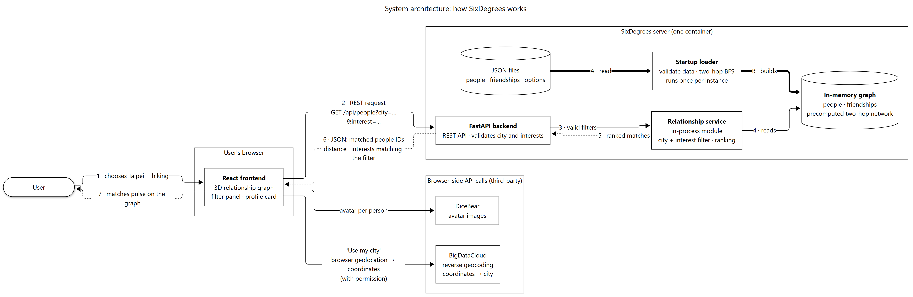
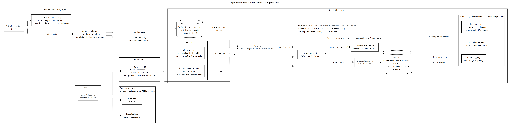

# SixDegrees (近緣)

SixDegrees is a demo web application for exploring people within two friendship hops of
a fixed demo user, filtered by city and interests. All people and friendships are
fictional.

## Demo

**Live demo:** <https://sixdegrees-eboobdh2da-de.a.run.app> (Google Cloud Run, asia-east1).
The service scales to zero, so the first request after a quiet period may take a few
seconds.

## Features

- Relationship graph of the demo user, direct friends, and friends of friends
- Person details, including the direct friends who connect to a second-degree contact
- Filtering by one city and any number of interests (interests match with OR; city and interests combine with AND)
- "Use my city": fills in the city filter from the device location, on request only
- Illustrated avatars for every person, with a local fallback image

The user interface is in Traditional Chinese; code and documentation are in English.

## Architecture

### System architecture



- **React frontend:** draws the 3D relationship graph and sends searches as REST requests.
- **FastAPI backend:** validates the city and interest filters and returns JSON.
- **Relationship service:** an in-process module that filters and ranks people.
- **In-memory graph:** people, friendships and the precomputed two-hop network.
- **Read-only JSON dataset:** bundled with the application.

At startup the data is loaded and validated once, and the two-hop network is built in
memory with a breadth-first search. Each request then only filters and ranks that network.
Avatars and reverse geocoding are called from the browser, not from the backend.

### Deployment architecture



- **GitHub:** public repository; GitHub Actions runs CI only.
- **Docker:** one image holds the API and the built frontend, built on the operator's machine.
- **Artifact Registry:** private repository; images are deployed by digest.
- **Cloud Run:** runs the container in `asia-east1` behind Google-managed HTTPS.
- **Cloud Logging and Cloud Monitoring:** request logs, app logs and metrics, built into Cloud Run.

More diagrams: [CI/CD flow](docs/diagrams/output/3-ci-cd-flow.png),
[personal Git flow](docs/diagrams/output/4-git-personal-flow.png) and
[team Git flow](docs/diagrams/output/5-git-team-flow.png).

## Design decisions

### Why JSON files instead of a database?

- The dataset is small, fictional and read-only.
- It ships inside the image and is versioned in Git together with the code.
- No database to provision, secure or pay for, and no external dependency at runtime.
- Tests run against the same fixed data, so results are deterministic.

The trade-off: changing the data means building a new image. Sign-in and user-written data
would need a database.

### Why an in-memory graph built at startup?

- The data is validated once per instance with strict Pydantic models and consistency
  checks. Invalid data stops startup, the `/health` startup probe fails, and the broken
  revision never receives traffic.
- The two-hop search runs once, so requests do no graph traversal; they only filter and
  rank, and answer from memory.

This works because there is one fixed viewer and little data. Per-user networks would be
computed per request instead (see [Future improvements](#future-improvements)).

### Why Cloud Run?

- It runs the container as it is, with no servers to manage.
- It scales to zero and bills per request, which suits a small demo with little traffic.
- HTTPS is managed by Google.
- One service serves both the frontend and the API: one URL and one unit to deploy.

The trade-off is a cold start on the first request after the service has scaled to zero.

## Tech stack

| Layer | Technology |
| --- | --- |
| Frontend | React, Vite, JavaScript (JSX), CSS; 3D graph rendered with three.js (WebGL) |
| Backend | Python 3.12, FastAPI, Pydantic |
| Runtime | Uvicorn |
| Data | Read-only JSON files bundled with the application |
| Testing | pytest with FastAPI TestClient; Node.js built-in test runner |
| Container | Docker (multi-stage build, non-root user) |
| Cloud | Google Cloud Run, Artifact Registry, Cloud Logging, Cloud Monitoring |
| Infrastructure as code | Terraform |
| CI | GitHub Actions |

## API

All endpoints are read-only `GET` requests.

| Path | Description |
| --- | --- |
| `/health` | Health check with the running version |
| `/api/options` | All 22 Taiwan cities and the five interests |
| `/api/network` | The two-hop subgraph: viewer, nodes with `distance` and `via_ids`, and edges |
| `/api/people` | Search results ordered by distance, matched interest count, then ID |

Example:

```
GET /api/people?city=taipei&interest=hiking&interest=museum
```

```json
{
  "items": [
    {"id": "u01", "distance": 1, "matched_interest_count": 2, "matched_interest_ids": ["hiking", "museum"]},
    {"id": "u05", "distance": 2, "matched_interest_count": 2, "matched_interest_ids": ["hiking", "museum"]}
  ]
}
```

Unknown or empty `city` / `interest` values return `422`. A valid city with no matching
people returns `200` with an empty `items` array.

## Local development

Commands use PowerShell 7 (`pwsh`) on Windows. Requirements: Python 3.12 and Node.js 26 LTS.

### Backend

```powershell
py -3.12 -m venv .venv
.venv\Scripts\python.exe -m pip install -r requirements-dev.txt

# Run the test suite
.venv\Scripts\python.exe -m pytest

# Start the API with auto-reload on http://localhost:8000
.venv\Scripts\python.exe -m uvicorn app.main:create_app --factory --reload
```

### Frontend

In a second terminal, with the backend running:

```powershell
cd frontend
npm ci

# Run the unit tests
npm test

# Start the Vite dev server on http://localhost:5173 (proxies /api to port 8000)
npm run dev
```

### Serve the production build from FastAPI

```powershell
cd frontend; npm run build; cd ..
$env:REQUIRE_FRONTEND = "1"
.venv\Scripts\python.exe -m app   # http://localhost:8080
```

### Run the container

The production image is a multi-stage build: a Node stage builds the frontend, and the
final Python image serves the API and the built files as a non-root user. Docker Desktop
with the WSL2 engine is enough on Windows.

```powershell
docker build --build-arg GIT_SHA=dev --tag sixdegrees:local .
docker run --rm --name sixdegrees --publish 8080:8080 sixdegrees:local   # http://localhost:8080
```

With the container running, a second terminal can run the same smoke test as CI:

```powershell
.venv\Scripts\python.exe scripts\smoke_test.py --base-url http://127.0.0.1:8080 --expected-version dev --container sixdegrees
```

## Deployment

The service runs on Google Cloud Run in `asia-east1`, with images in a private Artifact
Registry repository. Terraform ([infra/](infra/)) manages the Cloud Run service and its
runtime service account, which has no project-level IAM roles.

See [docs/deployment.md](docs/deployment.md) for the full release steps, service settings,
rollback and removal.

## CI/CD

GitHub Actions ([.github/workflows/ci.yml](.github/workflows/ci.yml)) runs on every pull
request and every push to `main`:

- Backend tests (pytest)
- Frontend tests and production build
- Terraform format check and validation, without cloud credentials
- Container build and smoke test

CI holds no cloud credentials and never pushes images. Deployment is intentionally manual:
release scripts build and push the image, and Terraform deploys it after its plan has been
reviewed.

## Third-party services

Both services are called directly from the browser; the backend, its health check and CI
never call them. Neither needs an API key.

| Service | Purpose | If it fails |
| --- | --- | --- |
| [DiceBear](https://www.dicebear.com/) | Avatar for each person | Falls back to a local avatar image |
| [BigDataCloud](https://www.bigdatacloud.com/) | Reverse geocoding for "Use my city" | Keeps the current city and asks for a manual choice |

Coordinates are used for that one lookup only: they are not stored, logged or sent to the
SixDegrees backend. See [docs/third-party-services.md](docs/third-party-services.md) for
the requests, the city mapping and the failure cases.

**Attribution.** Avatars are "Personas" by Draftbit, provided through DiceBear and
licensed under [CC BY 4.0](https://creativecommons.org/licenses/by/4.0/). The site crops
them to circles and shows people who do not match the current filter in greyscale.

## Configuration

| Variable | Default | Purpose |
| --- | --- | --- |
| `PORT` | `8080` | Listening port for `python -m app` |
| `APP_VERSION` | `dev` | Version reported by `/health` |
| `FRONTEND_DIST_DIR` | `frontend/dist` | Location of the built frontend |
| `REQUIRE_FRONTEND` | `0` | When `1`, startup fails if the frontend build is incomplete |

## Diagrams

The diagrams are written in Mermaid ([docs/diagrams/src/](docs/diagrams/src/)) and rendered
to PNG with a pinned Mermaid CLI. Rendering uses an installed Chrome or Edge (or the
browser in `CHROME_PATH`) instead of downloading one:

```powershell
cd docs/diagrams
npm ci
npm run render
```

## Future improvements

- Sign-in, so each person sees their own network instead of a fixed demo user
- People and friendships stored in a database (for example PostgreSQL), with profiles that users edit
- Each user's two-hop network computed per request, or updated incrementally, instead of one precomputed graph
- Handling of highly connected "super nodes" and per-user privacy settings
